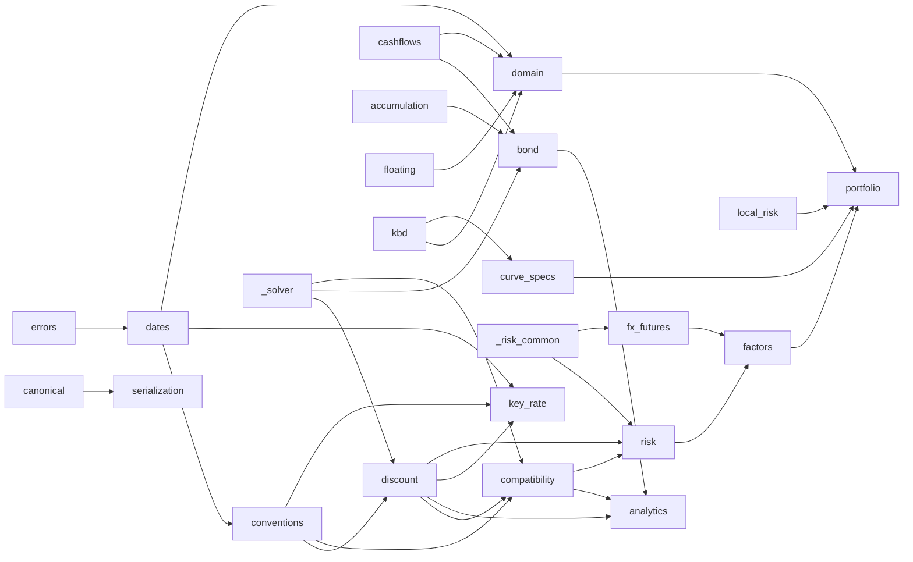

# Architecture

`rub_fixed_income` is a pure-Python (numpy only) deterministic calculation core for RUB
fixed income. It has no I/O, network, database, MCP, or UI code. Callers pass explicit
inputs (cash flows, prices, curves, calendars, conventions) and receive plain dataclasses
or floats.

## Module map

| Module | Responsibility |
| --- | --- |
| `conventions.py` | Immutable, hashable convention objects: `DayCount`, `Compounding` (`ANNUAL`, `MONTHLY`, `CONTINUOUS`, ...), `BusinessDayConvention`, `adjust_date`, `SettlementConvention`, `ScheduleConvention` + `generate_schedule`, `YieldConvention`, `ZSpreadConvention`, `CurveConvention`, `calendar_fingerprint`. |
| `_solver.py` | The single internal bracketed bisection (`bisect` → `RootResult`). Every solver in the package uses it. Private. |
| `dates.py` | Legacy helpers: `year_fraction` (ACT/365F), `add_months` (end-of-month clamp), legacy `annual_schedule`, `BusinessCalendar` (explicit holiday / working-day overrides + version label). |
| `cashflows.py` | `EventKey`, `CashEvent`, `BondCashflow`; clean %↔dirty RUB conversion. |
| `accumulation.py` | `AccumulationPeriod`, constant daily-compounded financing periods. |
| `bond.py` | Effective annual yield to a horizon (`solve_effective_annual_yield`); event-driven financed-bond projection (`project_financed_bond`). |
| `discount.py` | `DiscountCurve` (log-linear DF interpolation, flat-forward extrapolation, zero/forward/par rates), `OisQuote`, `bootstrap_discount_curve`. |
| `compatibility.py` | Function-style API used by most consumers: `solve_nominal_annual_yield`, `bond_duration`, `price_cashflows`, `solve_z_spread`, `solve_continuous_z_spread`, `clean_price_pct_to_dirty_amount`. |
| `analytics.py` | Snapshot-based deep interface: `analyze_bond` (V1, frozen conventions) and `analyze_bond_v2` (explicit conventions recorded in the result); canonical JSON/SHA-256 and result-hash verification; `accrued_interest_rub`. |
| `trade_grid.py` | Validated PCHIP price→metric grids with identity checks and exact fallback. |
| `key_rate.py` | MOEX IRS KEYRATE swap pricing and the identified pillar-forward key-rate curve build. |
| `risk.py` | Bond DV01/KRD, spread risk, scenarios, Hessian, JTD; shared curve shocking (`ShockedCurveCache`). |
| `fx_futures.py` | FX futures against RUB: covered-parity price, two-curve rate risk, basis, FX delta, scenarios, Hessian. |
| `_risk_common.py` | Private internals shared by `risk` and `fx_futures`: bucket weights, curve snapshotting and shocking, `ShockedCurveCache`, central derivatives, curve identity (0.12.0). |
| `floating.py` | Fixing-aware floating coupons: `FixingHistory`, `FloatingCouponRule`, `FloatingLeg` (0.8.0). |
| `local_risk.py`, `local_worker.py` | Per-bond risk adapter and the v1 portfolio worker over `PublicBondSnapshot` (0.5.0–0.7.0). |
| `public_schedule.py` | Deprecated bridge from the retired market-data-store schedule payload. |
| `canonical.py` | Canonical JSON bytes and SHA-256 identities (0.9.0). |
| `serialization.py` | `to_dict` / `from_dict` for core dataclasses (0.9.0). |
| `errors.py` | Typed rejections with stable codes, all `ValueError` (0.9.0). |
| `domain.py` | `Instrument`, `MarketSnapshot`, `Position` and their parts (0.10.0). |
| `kbd.py` | MOEX KBD/G-curve evaluator, G-spread, materialised curve (0.11.0). |
| `curve_specs.py` | Versioned curve-spec registry keyed by core spec IDs (0.11.0). |
| `factors.py` | Desk factor vocabulary `IR\|curve\|bucket`, `CS`, `FX\|ccy`; sparse Hessian (0.11.0). |
| `portfolio.py` | `value_portfolio`: a book against one `MarketSnapshot`, coded coverage, result contract v2 (0.11.0); `horizon_portfolio` (0.14.0). |
| `horizon.py` | Carry, rolldown and P&L explain to a horizon date (0.14.0). |
| `_deprecation.py` | `DeprecationWarning` helper for APIs kept until 1.0 (0.12.0). |
| `tenors.py` | Tenor codes: `parse_tenor`, `add_tenor`, `resolve_tenor` with spot lag and business-day convention (0.16.0). |
| `fx_forwards.py` | OTC FX forwards and FX swaps by covered parity, value dates on joint calendars, implied foreign curve (0.19.0). |
| `callables.py`, `pass_through.py`, `assumed_portfolio.py` | Exercise assumptions for callables and perpetuals; constant-CPR pass-throughs; assumption-recording portfolio wrapper (0.20.0). |
| `swaps.py` | Seasoned RUONIA OIS and key-rate swaps: schedules, known resets, two curves, risk, carry (0.21.0). |
| `inflation.py`, `linkers.py` | Point-in-time CPI, OFZ-IN indexation, indexed legs, real-curve cashflows (0.23.0). |
| `cds.py` | ISDA Standard Model single-name CDS: hazard bootstrap, quote conversions, risk, JTD (0.24.0). |
| `xccy.py` | CNY/RUB cross-currency swaps vs RUONIA and the CNY curve bootstrap (0.25.0). |
| `rate_futures.py`, `ofz_futures.py` | MOEX RUON, RUONIA index, KEYRATE and OFZ basket futures (0.27.0). |
| `repo.py` | Repo and reverse-repo legs; collateral as a reference outside PV (0.28.0). |
| `portfolio_instruments.py`, `portfolio_products.py` | Derivative position types and the per-product adapters behind `value_portfolio`'s result contract v3 (0.29.0). |
| `_money.py`, `_version.py` | Private money validation helpers; the single runtime version. |

Dependency direction (no cycles):

## Data flow

1. **Curve**: `OisQuote[]` + `CurveConvention` → `bootstrap_discount_curve` → `DiscountCurve`
   (or the caller constructs `DiscountCurve(curve_date, nodes)` from stored DFs).
2. **Bond price**: clean % of current nominal + accrued interest (RUB per bond) → dirty RUB per
   bond (`clean_price_pct_to_dirty_rub`).
3. **Yield**: dirty + future cash flows + settlement + `YieldConvention` → nominal yield
   (`solve_nominal_annual_yield`) → `bond_duration`.
4. **Spread**: dirty + future cash flows + `DiscountCurve` + optional `settlement_date` +
   `ZSpreadConvention` → `solve_z_spread`.
5. **Snapshot analytics**: `BondTermsV1`, schedule, `MarketObservationV1`, `CurveSnapshotV1`,
   `ValuationContext`, `CalculationPolicy` → `analyze_bond[_v2]` → hashed result or
   `CalculationFailure`.
6. **Portfolio (0.11.0)**: `Instrument[]` + `Position[]` + one `MarketSnapshot` (curves by ID
   with spec IDs, calendars, fixings, FX, quotes) + `ValuationPolicy` → `value_portfolio` →
   `PortfolioRiskResult` (per-position PV, spreads, desk-factor risk, JTD; coded coverage;
   hash-verified contract `rub-portfolio-risk-result.v2`).

## Invariants

- All dataclasses are `frozen=True`; convention objects are hashable and have a stable
  `identifier` string for provenance/hashing (calendar identity = version label + content
  fingerprint of holiday/working-day sets).
- Defaults reproduce rub-fixed-income-core 0.2.1 numbers bit for bit (verified by a bitwise
  probe over curves, yields, durations, spreads, `analyze_bond`, schedules): ACT/365F time,
  annual compounding, legacy unadjusted OIS fixed-leg schedule, curve-date valuation when no
  settlement is passed, V1 analytics continuous Z-spread.
- `DiscountCurve` nodes are strictly increasing after `curve_date` with finite positive DFs.
- Cash flows on or before settlement are never valued when a settlement date is given;
  accrued interest at the coupon payment date is 0.
- Every root is bracketed explicitly; no solver returns a bracket edge as an answer.

## Error model

- **`CoreRejection`** (0.9.0, a `ValueError`) – typed rejections with a stable `code`:
  `UnsupportedProduct`, `MissingMarketData`, `CalendarRangeError`, `UnknownCurveSpec`,
  `InvalidTerms`. `value_portfolio` records them per position instead of raising.
- **`ValueError`** – invalid input (non-finite / non-positive price, non-finite cash flows,
  spreads, yields, quotes, DFs; settlement before curve date; no future cash flow; invalid
  conventions) and **unbracketed roots** (message contains `"not bracketed"`), including a
  nominal yield below `-0.99·m` and non-finite objective values met during bisection.
- **`RuntimeError`** – a bracketed solver exhausted its iteration budget (`"did not converge"`),
  or a bootstrapped curve failed its exact repricing self-check.
- **`TypeError`** – `Compounding` given a non-integer frequency.
- `analyze_bond` / `analyze_bond_v2` never raise for calculation problems; they return
  `CalculationFailure(code, message)` with codes `INVALID_UNITS`, `SOLVER_NOT_BRACKETED`,
  `SOLVER_NON_CONVERGENCE`, `NON_FINITE_RESULT`, `CASHFLOW_INCOMPLETE`,
  `QUOTE_CURVE_DATE_MISMATCH`.

## Solver (`_solver.bisect`)

Bisection on `[lower, upper]` with: finite ordered bracket; finite endpoint values (unless the
caller supplies an analytically known endpoint value such as `+inf`); sign change required;
every interior evaluation must be finite (raises, never continues); stop on `|f| <= tol`,
interval width `<= x_tol`, or float-adjacent bracket; otherwise `RuntimeError`. Returns
root, iteration count, and the residual. Brackets/tolerances per caller:

| Caller | Bracket | f-tol | x-tol | max it |
| --- | --- | --- | --- | --- |
| nominal yield | `(-m+1e-12, upper)`, upper doubled from 1.0 to 1e6 | 1e-12 | – | 256 |
| effective yield to horizon | `(-0.99, 5.0)` | 1e-13 | 1e-13 | 240 |
| Z-spread m-periodic | `(-0.95, 5.0)` | 1e-13 | 1e-13 | 240 |
| Z-spread continuous | `(-5.0, 5.0)` | 1e-13 | 1e-13 | 240 |
| `analyze_bond` spread (bp) | `CalculationPolicy` bounds (default ±5000 bp) | policy | policy | 240 |
| OIS bootstrap forward | dynamic, from `(-0.5, 2.0)` doubled ×12 | 1e-14 | – | 240 |
